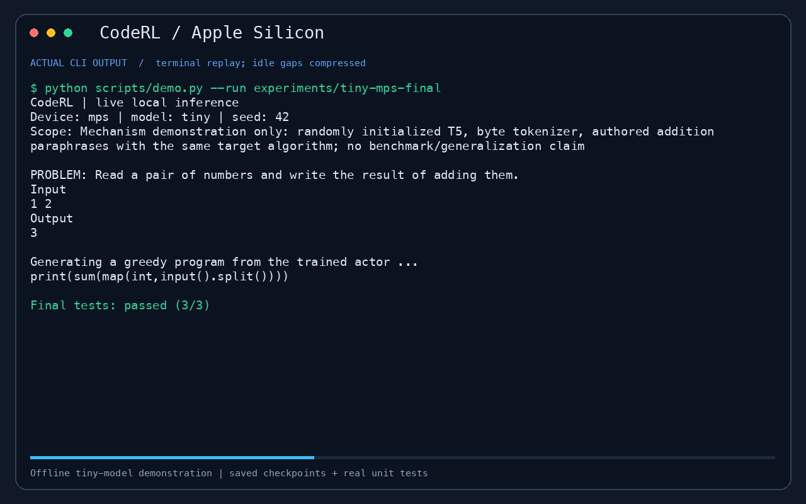
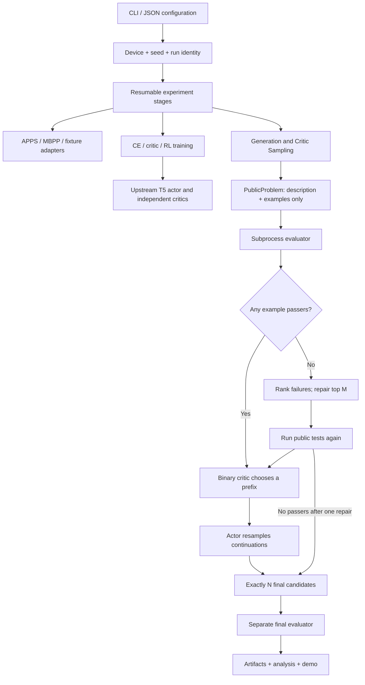

# CodeRL-Mac

CodeRL for Apple Silicon, featuring native MPS and CPU support, actor–critic reinforcement learning, critic-guided program repair, and reproducible end-to-end local experiments.

[English](README.md) · [简体中文](README.zh-CN.md) · [Original upstream README](legacy/README.upstream.md)

An executable Apple Silicon modernization of **[CodeRL: Mastering Code Generation through Pretrained Models and Deep Reinforcement Learning](https://arxiv.org/abs/2207.01780)** (NeurIPS 2022). It preserves CodeT5 program generation, execution-based rewards, the learned critic and the combined supervised/RL objective, and completes the previously unreleased **Critic Sampling** workflow.

**Runs locally on M1 with MPS or CPU.** No CUDA, DeepSpeed, API key or paid model service is needed. Tested on an Apple M1 Pro with 16 GB memory, macOS 26.6.1, native arm64 Python 3.11, PyTorch 2.9.1 and Transformers 4.46.3. [Environment evidence](docs/m1-environment.json).

> **Reproduction scope:** the saved experiments are actual, reduced-scale runs. They are not a reproduction of the paper's 770M model or published benchmark scores. The offline demo uses an explicitly labeled tiny model; the benchmark smoke run uses the official 60M CodeT5-small checkpoint. Full pretraining, large generation budgets, causal-model comparisons and the CodeXGLUE appendix remain outstanding. See the [complete coverage audit](docs/paper-coverage.md).

## Demo

[](docs/assets/demo.mp4)

**[Watch / download the MP4](docs/assets/demo.mp4)** · [Animated preview](docs/assets/demo.gif) · [Exact captured output](docs/assets/demo-capture.json) · [Programs, test outcomes and critic traces](docs/assets/demo-session.json)

The video replays real terminal output from device checks and live inference using saved checkpoints, with idle gaps compressed. It shows code generation, execution, critic-guided sampling and the resulting test outcomes. The small addition fixture demonstrates the workflow; it does not measure APPS generalization. GitHub may require opening the MP4 link to play/download it.

## Quick start

Use a **native arm64 Python 3.11** on Apple Silicon (`uname -m` should print `arm64`). From the repository root:

```bash
python3.11 -m venv .venv
source .venv/bin/activate
export TOKENIZERS_PARALLELISM=false
python -m pip install -e '.[dev]'
coderl doctor
pytest -q

# Offline end-to-end run, including every local ablation and Critic Sampling.
coderl run --config configs/tiny.json --output experiments/my-tiny-run

# Real pretrained CodeT5-small + frozen APPS and MBPP subsets.
# First use downloads the pinned public model (~240 MB).
coderl run --config configs/m1.json --output experiments/my-m1-run
```

The tiny profile requires no network after dependency installation. The official small-model profile caches its pinned model on first use. The selected benchmark records are included in `data/benchmarks/`, so execution does not depend on a live dataset service.

For the exact tested dependency snapshot, use `python -m pip install -r requirements-lock-macos-arm64.txt` instead of the editable-install line. The lock is specific to Python 3.11/macOS arm64; other platforms should use the package dependencies. **Do not install the legacy `transformers/` fork.**

```bash
# Explicit CPU fallback, useful on machines without MPS.
coderl run --config configs/tiny.json --device cpu --output experiments/my-cpu-run

# Stop after a stage, inspect its artifacts, then continue.
coderl run --config configs/tiny.json --output experiments/staged --stop-after scores
coderl run --config configs/tiny.json --output experiments/staged --resume

# Rebuild charts and analysis from measured results.
coderl report experiments/my-m1-run

# Live demo, or regenerate the video from a completed tiny run.
python scripts/demo.py --run experiments/my-tiny-run
python scripts/record_demo.py --run experiments/my-tiny-run
```

Output directories are never silently overwritten. Resume checks source, configuration, dataset and artifact hashes. It resumes at completed **stage boundaries**; an interrupted training stage restarts from its upstream checkpoint. Use a new directory after changing source or configuration.

## What changed

- Native `auto → MPS / CUDA / CPU` device selection; FP32 on MPS; explicit microbatches, gradient accumulation, dynamic padding and decoder caching.
- A small, installable `src/coderl/` package replaces the dependency on the 2022 Transformers fork and the copied multi-thousand-line trainer. Original project code is preserved under `legacy/`; original data and images remain available.
- Complete four-class critic, separate binary critic, greedy baseline, dense token returns, CE + RL training, repair-model training, prefix refinement and top-M repair.
- APPS stdin/function calls and MBPP assertions execute in bounded subprocesses. On macOS, an OS execution policy blocks network access, subprocess forks, home-directory reads and writes outside a temporary working directory.
- Public examples are structurally separated from hidden tests and reference solutions. Missing tests cannot produce a passing score.
- Correct finite-sample pass@k, example-filtered n@k, difficulty breakdowns, ranked beam evaluation, original program/error records and problem-level bootstrap intervals.
- Immutable run manifests, source snapshots, stage hashes, loss traces, checkpoints, generated programs, CS traces, plots and bilingual documentation.

## Data flow

```mermaid
flowchart LR
    A[Training problems + reference code] --> P[MSP / NTP objectives]
    P --> S[CodeT5 supervised warm start]
    S --> G[Sampled programs + greedy baseline]
    G --> X[Bounded unit-test execution]
    X --> R[Four outcomes and relative rewards]
    A --> C[Four-class critic training]
    R --> C
    C --> Q[Probability of observed outcome per token]
    Q --> RL[CE + dense policy-gradient loss]
    R --> RL
    A --> RL
    RL --> F[Finetuned actor]
    X --> B[Binary critic + repair model]
    F --> CS[Critic Sampling on public examples]
    B --> CS
    CS --> H[Final hidden-test evaluation]
    H --> E[Metrics / JSONL / plots / report]
```



The critic weight is the probability of the **actual execution outcome**, not always the probability of success. For token `t`, the policy weight is `(reward(sample) − reward(greedy)) × q(outcome | token t)`. The critic is frozen while training the actor. Reference CE and policy loss have equal weight. Padding contributes to neither loss nor critic pooling.

## Architecture and inference flow



No-example problems bypass CS. Repair/refine have finite budgets; failed repair does not loop forever. No hidden test or reference answer is passed to the sampling function. MBPP includes its published assertions in the prompt, as required by the original protocol.

## Recorded experiments

[Cross-run results and analysis](experiments/RESULTS.md) · [All metrics as CSV](experiments/summary.csv) · [83 upstream-program compatibility checks](experiments/upstream-reexecution/summary.json)

| Run | Model / data | Evidence |
|---|---|---|
| MPS mechanism run | 694,528-parameter T5, byte tokenizer; authored addition paraphrases | [Analysis](experiments/tiny-mps-final/analysis.md) · [Manifest](experiments/tiny-mps-final/manifest.json) |
| CPU mechanism run | Same offline profile on CPU | [Analysis](experiments/tiny-cpu-final/analysis.md) · [Manifest](experiments/tiny-cpu-final/manifest.json) |
| M1 benchmark smoke run | Pinned 60,492,288-parameter CodeT5-small; 5 APPS train, 6 APPS test; 4 MBPP train, 3 MBPP test | [Analysis](experiments/m1-codet5-small/analysis.md) · [Manifest](experiments/m1-codet5-small/manifest.json) |
| Dataset overlap audit | 101 bundled APPS reference programs vs all 974 MBPP programs | [Raw analysis](experiments/dataset-overlap.json) |

The final profiles completed **91 stages in total** (29 MPS tiny, 29 CPU tiny, 33 pretrained). Stage times were approximately 116 s, 33 s and 918 s; these include local work and are not controlled hardware benchmarks. The pretrained smoke run measured **0% pass@1 on its six APPS test problems**; all three MBPP evaluation variants also produced no passing candidate. These negative results are retained. See the [failure and critic diagnostics](experiments/m1-codet5-small/diagnostic-analysis.md); critic accuracy on a single observed class is not evidence of a strong critic.

Each completed run follows this order:

1. MSP, then NTP updates using training code only.
2. Supervised actor warm start.
3. Actual stochastic rollouts and greedy programs; execute both.
4. Train four-class and binary critics; export token scores.
5. Train an independent program-repair model.
6. Evaluate SFT; independently train and evaluate `coderl`, `no_critic`, `absolute`, `distance`, `ce_only`, `ce_synthetic` and `rl_only` from the same warm start.
7. Evaluate nucleus generation, refinement alone, and refinement + repair with M = 1, 2, 4.
8. For the pretrained profile: MBPP zero-shot transfer from SFT and CodeRL, plus separate MBPP supervised finetuning and evaluation.
9. Save original observations and derive reports/figures from them.

Every score is limited to its actual sample budget. Five generations cannot establish pass@80 or pass@1000. Beam top-k success is distinguished from the unbiased sampling estimator. Critic Sampling's dependent generations require additional caution when interpreting the estimator. Tiny runs with two evaluation problems and few optimizer steps do not establish statistical improvement.

## Configuration and data

[`configs/tiny.json`](configs/tiny.json) is the offline mechanism profile. [`configs/m1.json`](configs/m1.json) is the pretrained smoke profile. Defaults and the stage graph are in [`pipeline.py`](src/coderl/pipeline.py). Set model/checkpoint, source/target lengths, optimization steps, sample counts, batch sizes, device and seed in a copied configuration.

APPS input can be a normal directory of problem folders (`question.txt`, `solutions.json`, `input_output.json`, optional `starter_code.py`, `metadata.json`, `example_input_output.json`) or the normalized JSONL format included here. MBPP follows the original task-ID split: 1–10 prompts, 11–510 test, 511–600 validation, 601–974 train. References and hidden tests stay in the dataset object; inference receives its restricted public view.

- [Frozen benchmark provenance and hashes](data/benchmarks/provenance.json)
- [Model revision](docs/references/model.json)
- [Reference-program validation](experiments/reference-validation.json)
- Refresh the bounded public subsets: `python scripts/prepare_data.py`.
- Regenerate the authored fixture: `python scripts/create_fixtures.py`.

The evaluator intentionally retains output ordering. Some APPS tasks have nonunique valid answers and need special checkers; mismatching reference programs are recorded. The modern checker does not reproduce every permissive heuristic of the old APPS evaluator. See the coverage audit before comparing scores.

## Project layout

```text
src/coderl/           modern runtime, data, models, training, sampling, evaluator, reports
configs/              runnable offline and M1 experiment profiles
scripts/              dataset preparation, live demo, video capture and analysis helpers
tests/                numerical, execution, sampling and artifact-integrity tests
data/benchmarks/      frozen APPS/MBPP subsets + provenance
experiments/          measured records, metrics, plots, analysis and local checkpoints
docs/                 paper audit, environment evidence, references and demo assets
legacy/               preserved 2022 entry points, trainer, datasets and scripts
transformers/         untouched original fork, retained for reference only
```

Large local checkpoints are excluded from Git, but saved under each run's `checkpoints/`. Metrics, logs, program samples, plots and manifests are normal project artifacts. Re-running the pinned configuration regenerates checkpoints. `source.zip` preserves the exact package source used by each final run.

## Validation and limits

```bash
make test
coderl doctor --device mps
coderl doctor --device cpu
```

The recorded test suite contains 35 passing checks. Tests check reward values, gradient direction and detachment, zero-advantage behavior, padding invariance, checkpoint round trips, exact sample counts with remainder batches, repair/refine branches, public/hidden separation, combinatorial metrics, subprocess timeout/side effects and resume integrity. CI is configured for macOS and Linux; the recorded local tests are on M1. MPS is seeded but is not guaranteed bitwise deterministic across runs or PyTorch/macOS versions.

This implementation currently supports **T5/CodeT5 encoder-decoder models**. It does not implement the paper's GPT-Neo/GPT-J experiments, full-scale pretraining corpus pipeline or CodeXGLUE benchmark suite. Those omissions are listed explicitly in [paper-coverage.md](docs/paper-coverage.md).

## Attribution

Original authors: Hung Le, Yue Wang, Akhilesh Deepak Gotmare, Silvio Savarese and Steven C. H. Hoi. Original implementation: [Salesforce/CodeRL](https://github.com/salesforce/CodeRL). [BSD-3-Clause project license](LICENSE.txt); pretrained models and datasets retain their own licenses and attribution. See [dataset attribution](data/benchmarks/README.md).

```bibtex
@inproceedings{le2022coderl,
  title={CodeRL: Mastering Code Generation through Pretrained Models and Deep Reinforcement Learning},
  author={Le, Hung and Wang, Yue and Gotmare, Akhilesh Deepak and Savarese, Silvio and Hoi, Steven C. H.},
  booktitle={Advances in Neural Information Processing Systems},
  year={2022}
}
```
