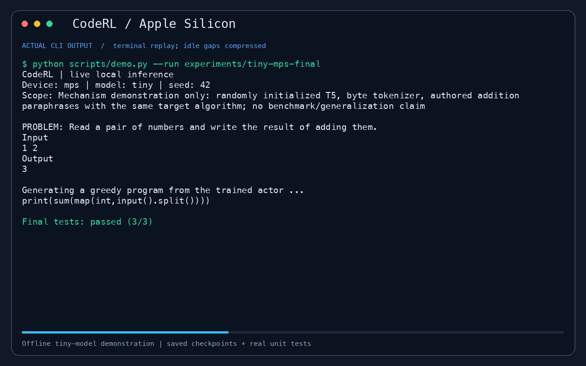
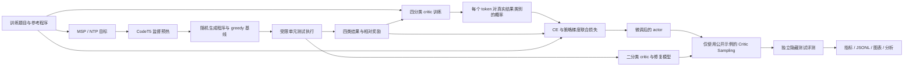
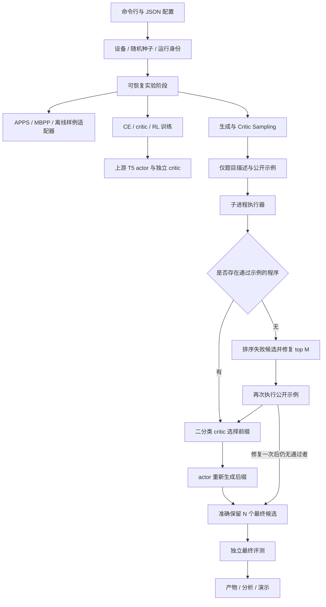

# CodeRL-Mac：Apple Silicon 原生运行版

[English（默认）](README.md) · [简体中文](README.zh-CN.md) · [原始项目 README](legacy/README.upstream.md)

本项目对 NeurIPS 2022 论文 **[CodeRL: Mastering Code Generation through Pretrained Models and Deep Reinforcement Learning](https://arxiv.org/abs/2207.01780)** 的官方实现进行了现代化改造。保留 CodeT5 代码生成、单元测试奖励、学习式 critic 和监督学习与强化学习联合优化的核心方法，并补全原仓库尚未发布的 **Critic Sampling** 推理流程。

**支持 M1 Mac 上的 MPS 加速和 CPU 运行**，不需要 CUDA、DeepSpeed、API Key 或付费模型服务。实际验证环境：Apple M1 Pro、16 GB 内存、macOS 26.6.1、原生 arm64 Python 3.11、PyTorch 2.9.1、Transformers 4.46.3。[环境检测记录](docs/m1-environment.json)。

> **复现范围：** 项目保存的是实际执行的缩小规模实验，并非论文 770M 模型和完整榜单的复现。离线演示使用明确标注的微型模型；真实数据实验使用官方 60M CodeT5-small。完整预训练、大规模采样、因果模型对比和 CodeXGLUE 附录实验仍未完成。请阅读[逐项论文覆盖审计](docs/paper-coverage.md)，不能将“流程可运行”理解为“100% 复现论文”。

## 演示视频

[](docs/assets/demo.mp4)

**[观看或下载 MP4](docs/assets/demo.mp4)** · [GIF 预览](docs/assets/demo.gif) · [原始终端输出](docs/assets/demo-capture.json) · [生成程序、测试结果和 critic 轨迹](docs/assets/demo-session.json)

视频根据真实执行的设备检查和模型推理终端输出制作，压缩了等待时间。展示代码生成、代码执行、critic 引导的采样以及实际测试结果。加法小数据集用于演示机制，不代表 APPS 泛化性能。GitHub 页面可能需要点击 MP4 链接后播放或下载。

## 快速开始

使用 Apple Silicon **原生 arm64 Python 3.11**；`uname -m` 应输出 `arm64`。在项目根目录执行：

```bash
python3.11 -m venv .venv
source .venv/bin/activate
export TOKENIZERS_PARALLELISM=false
python -m pip install -e '.[dev]'
coderl doctor
pytest -q

# 离线端到端运行，包含本地消融实验及 Critic Sampling。
coderl run --config configs/tiny.json --output experiments/my-tiny-run

# 官方预训练 CodeT5-small + 固定的 APPS/MBPP 子集。
# 首次运行下载固定版本的公开权重，约 240 MB。
coderl run --config configs/m1.json --output experiments/my-m1-run
```

安装依赖后，tiny 配置可以完全离线运行。预训练模型首次使用需要下载，之后使用本地缓存。选定的真实基准数据已存放在 `data/benchmarks/`，运行不依赖实时数据接口。

如需安装本机验证过的精确依赖版本，可将上述安装命令替换为 `python -m pip install -r requirements-lock-macos-arm64.txt`。该快照针对 Python 3.11/macOS arm64；其他平台使用包中声明的依赖范围。**不要安装旧的 `transformers/` 分支。**

```bash
# CPU 完整运行。
coderl run --config configs/tiny.json --device cpu --output experiments/my-cpu-run

# 分步运行：导出 critic 分数后暂停，再从完成的阶段继续。
coderl run --config configs/tiny.json --output experiments/staged --stop-after scores
coderl run --config configs/tiny.json --output experiments/staged --resume

# 从真实数据重新生成分析及图表。
coderl report experiments/my-m1-run

# 运行演示，或重新录制终端输出并生成视频。
python scripts/demo.py --run experiments/my-tiny-run
python scripts/record_demo.py --run experiments/my-tiny-run
```

输出目录不会被静默覆盖。继续运行时会核对源代码、配置、数据和已有产物的哈希。恢复粒度是**已完成的阶段**，中断阶段的优化器状态不会继续，而是从上游检查点重做该阶段。修改代码或配置后请使用新目录。

## 改造内容

- 原生设备选择：`auto → MPS / CUDA / CPU`；MPS 使用 FP32；采用小批量生成、梯度累积、动态 padding 和解码缓存。
- 新建可安装的 `src/coderl/`，移除对旧版 Transformers 改写分支和数千行复制训练器的运行依赖。原始代码保留在 `legacy/`，原始数据和图片仍在项目中。
- 实现四分类 critic、独立二分类 critic、greedy baseline、token 级奖励、CE + RL 联合训练、独立修复模型、前缀细化和 top-M 修复。
- APPS 标准输入、函数调用和 MBPP assert 测试在受限子进程运行。macOS 下限制网络、派生进程、用户目录读取及临时目录外写入。
- 推理接口只接收公开示例，不接收隐藏测试或参考答案；没有测试的程序不会被计为通过。
- 正确计算有限样本 pass@k、示例过滤后的 n@k、分难度结果、beam top-k 和按题 bootstrap 区间。
- 保留运行清单、源码快照、阶段校验值、损失曲线、模型检查点、全部候选代码、错误信息、CS 轨迹、图表和分析。

## 数据流图



critic 权重是**实际测试结果类别**的概率，不是统一取“通过”概率。每个 token 的策略权重为 `(采样程序奖励 − greedy 程序奖励) × critic 对实际结果的概率`。优化 actor 时冻结 critic；参考答案 CE 和 RL 权重均为 1，padding 不参与损失和最大池化。

## 结构与推理流程图



没有公开示例的题目跳过 CS。修复和细化轮数有限，修复失败不会无限循环。采样函数不能接收隐藏测试或参考答案。MBPP 按原论文协议将公开 assert 放入输入提示。

## 已保存的实验

[跨实验汇总与分析](experiments/RESULTS.zh-CN.md) · [全部指标 CSV](experiments/summary.csv) · [83 个上游程序兼容性检查](experiments/upstream-reexecution/summary.json)

| 实验 | 模型与数据 | 证据 |
|---|---|---|
| MPS 机制验证 | 694,528 参数 T5、字节 tokenizer、自建加法同义题目 | [分析](experiments/tiny-mps-final/analysis.md) · [运行清单](experiments/tiny-mps-final/manifest.json) |
| CPU 机制验证 | 同一离线配置，CPU 执行 | [分析](experiments/tiny-cpu-final/analysis.md) · [运行清单](experiments/tiny-cpu-final/manifest.json) |
| M1 真实数据小规模实验 | 固定版本 60,492,288 参数 CodeT5-small；APPS 5 道训练题、6 道测试题；MBPP 4 道训练题、3 道测试题 | [分析](experiments/m1-codet5-small/analysis.md) · [运行清单](experiments/m1-codet5-small/manifest.json) |
| 数据重复检查 | 原仓库 101 份 APPS 参考程序与全部 974 份 MBPP 程序 | [原始分析](experiments/dataset-overlap.json) |

最终三轮共完成 **91 个阶段**（MPS tiny 29、CPU tiny 29、预训练模型 33），阶段总时间约为 116、33、918 秒；这些不是受控硬件性能基准。真实预训练模型在所选 6 道 APPS 测试题上的 **pass@1 为 0%**，三种 MBPP 评测也均未生成通过候选。负面结果全部保留，详见[失败及 critic 诊断](experiments/m1-codet5-small/diagnostic-analysis.md)；仅一个真实类别上的高 critic 准确率不能说明分类器足够好。

每轮完整实验按以下顺序执行：

1. 仅使用训练集程序执行 MSP、NTP 更新。
2. 用参考答案监督预热 actor。
3. 实际生成随机程序和 greedy 程序，并执行测试。
4. 训练四分类、二分类 critic，导出 token 分数。
5. 用失败程序和参考程序训练独立修复模型。
6. 评测 SFT；从相同预热检查点分别训练和评测 `coderl`、`no_critic`、`absolute`、`distance`、`ce_only`、`ce_synthetic`、`rl_only`。
7. 评测 nucleus sampling、仅细化、细化加修复，修复候选数 M 为 1、2、4。
8. 预训练模型配置额外执行 MBPP 零样本迁移和独立 MBPP 监督微调、评测。
9. 保存原始观测，并据此生成分析和图表。

指标严格受实际采样数限制：生成 5 个程序不能报告 pass@80 或 pass@1000。Beam top-k 与随机采样估计量分开报告。CS 的候选具有相关性，解释其估计指标时需要考虑这一点。仅两道题的机制演示和少量训练步数不能支持统计显著的性能改进结论。

## 配置与数据

[`configs/tiny.json`](configs/tiny.json) 是离线机制配置；[`configs/m1.json`](configs/m1.json) 是预训练模型配置。默认值和阶段图在 [`pipeline.py`](src/coderl/pipeline.py)。可复制配置调整模型、序列长度、训练步数、样本数、批量大小、设备和随机种子。

APPS 支持标准题目目录：`question.txt`、`solutions.json`、`input_output.json`，以及可选 `starter_code.py`、`metadata.json`、`example_input_output.json`；也支持项目提供的标准化 JSONL。MBPP 按原始任务编号划分：1–10 为提示样例，11–510 为测试，511–600 为验证，601–974 为训练。推理只接收数据对象的公开视图。

- [数据来源、选择规则与校验值](data/benchmarks/provenance.json)
- [模型版本](docs/references/model.json)
- [参考程序执行检查](experiments/reference-validation.json)
- 更新固定规模公开子集：`python scripts/prepare_data.py`。
- 重建自编离线样例：`python scripts/create_fixtures.py`。

评测器保留输出顺序；某些允许多种合法答案的 APPS 题需要专用 checker，参考答案不匹配情况已记录。现代执行器没有照搬旧 APPS 评测器的所有宽松比较规则。比较分数前请先阅读论文覆盖审计。

## 项目结构

```text
src/coderl/           设备、数据、模型、训练、采样、执行器与报告
configs/              离线和 M1 实验配置
scripts/              数据准备、实际演示、视频录制和分析工具
tests/                数值、执行、采样与产物完整性测试
data/benchmarks/      固定 APPS/MBPP 数据与来源
experiments/          实验记录、指标、图表、分析和本地检查点
docs/                 论文审计、环境证据、参考资料和演示视频
legacy/               保留的 2022 年入口、训练器、数据类和脚本
transformers/         未修改的原始分支，仅用于参考
```

大型模型检查点已保存到各实验的 `checkpoints/`，但默认不进入 Git；指标、日志、程序样本、图表和清单作为普通项目产物保留。重新运行固定配置可以生成检查点。每个最终实验的 `source.zip` 保存了实际使用的包源码。

## 验证与限制

```bash
make test
coderl doctor --device mps
coderl doctor --device cpu
```

已实测通过 35 项测试。测试覆盖奖励定义、梯度方向与 detach、零优势梯度、padding 不变性、检查点读写、非整除采样数量、修复及细化分支、公开和隐藏数据隔离、组合数指标、超时与副作用限制、恢复时完整性检查。项目配置了 macOS/Linux CI；已保存的本机验证来自 M1。MPS 设置了随机种子，但跨运行、PyTorch 或 macOS 版本不保证逐位一致。

现代实现目前支持 **T5/CodeT5 编码器—解码器模型**。论文中的 GPT-Neo/GPT-J 实验、完整预训练语料流水线及 CodeXGLUE 套件尚未实现。未完成项及实现差异均列在 [paper-coverage.md](docs/paper-coverage.md)。

## 致谢与引用

原作者：Hung Le、Yue Wang、Akhilesh Deepak Gotmare、Silvio Savarese、Steven C. H. Hoi。原实现：[Salesforce/CodeRL](https://github.com/salesforce/CodeRL)。项目遵循 [BSD-3-Clause](LICENSE.txt)；模型和数据保留各自的许可及来源，详见[数据归属说明](data/benchmarks/README.md)。

```bibtex
@inproceedings{le2022coderl,
  title={CodeRL: Mastering Code Generation through Pretrained Models and Deep Reinforcement Learning},
  author={Le, Hung and Wang, Yue and Gotmare, Akhilesh Deepak and Savarese, Silvio and Hoi, Steven C. H.},
  booktitle={Advances in Neural Information Processing Systems},
  year={2022}
}
```
