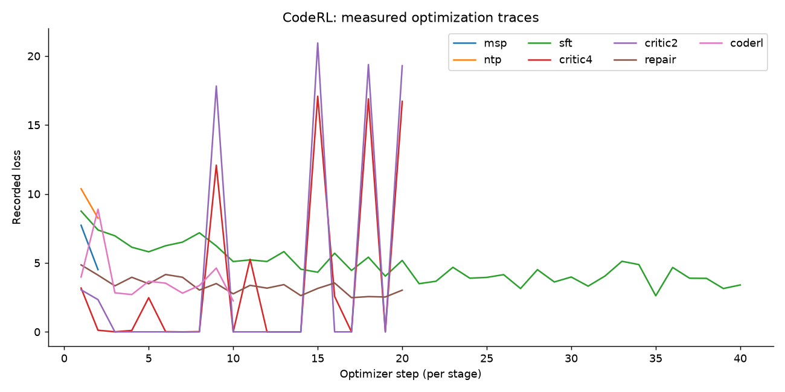
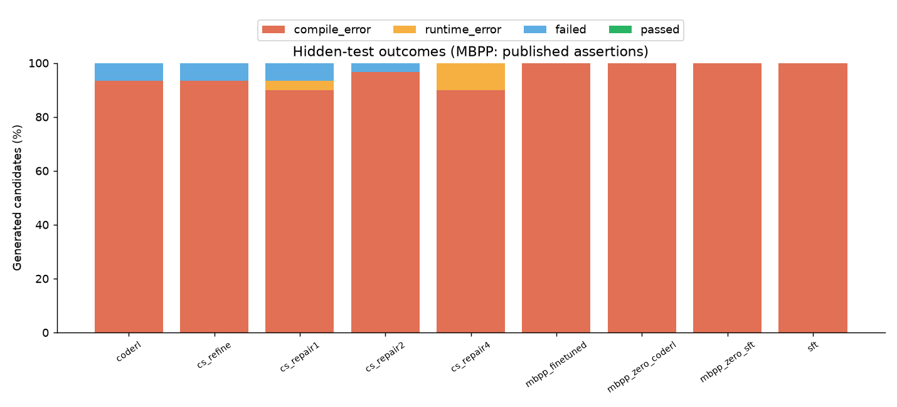

# Experiment report — m1-codet5-small

Scope: **Reduced-scale CodeT5-small mechanism/benchmark smoke experiment: 5 APPS train problems, 6 test problems (2 per difficulty), 3 MBPP test problems; not paper-scale reproduction**. Status: `complete`.
This is a measured local run, not a reproduction of the paper's published accuracy.

## Configuration and evidence

- Hardware: Apple M1 Pro; arm64; device `mps`.
- Model: `Salesforce/codet5-small`; seed 42; source/target limits 600/192.
- Measured stage time: 917.8 seconds. See [manifest](manifest.json) for configuration, versions, hashes and each stage's timing.
- [Events](events.jsonl), `training/`, `evaluations/`, `traces/`, `critic_scores.jsonl`, and `checkpoints/` contain original artifacts.
- MSP/NTP use this run's training reference corpus only. They exercise the objectives; they do not recreate CSN/GCPY pretraining.
- Each ablation starts from the same SFT checkpoint, uses the same frozen rollout bank and seed.

## Results

| Experiment | Problems | Candidates | pass@1 / beam top-1 | pass@5 / beam top-5 |
|---|---:|---:|---:|---:|
| absolute_beam | 6 | 30 | 0.000% | 0.000% |
| ce_only_beam | 6 | 30 | 0.000% | 0.000% |
| ce_synthetic_beam | 6 | 30 | 0.000% | 0.000% |
| coderl | 6 | 30 | 0.000% | 0.000% |
| coderl_beam | 6 | 30 | 0.000% | 0.000% |
| cs_refine | 6 | 30 | 0.000% | 0.000% |
| cs_repair1 | 6 | 30 | 0.000% | 0.000% |
| cs_repair2 | 6 | 30 | 0.000% | 0.000% |
| cs_repair4 | 6 | 30 | 0.000% | 0.000% |
| distance_beam | 6 | 30 | 0.000% | 0.000% |
| mbpp_finetuned | 3 | 15 | 0.000% | 0.000% |
| mbpp_zero_coderl | 3 | 15 | 0.000% | 0.000% |
| mbpp_zero_sft | 3 | 15 | 0.000% | 0.000% |
| no_critic_beam | 6 | 30 | 0.000% | 0.000% |
| rl_only_beam | 6 | 30 | 0.000% | 0.000% |
| sft | 6 | 30 | 0.000% | 0.000% |
| sft_beam | 6 | 30 | 0.000% | 0.000% |

Nucleus scores use the unbiased finite-population pass@k estimator; beam scores use ranked top-k success.
Critic Sampling produces dependent candidates: its estimator is descriptive and lacks the IID guarantee of independent nucleus draws.
Values for k greater than the observed population are never extrapolated. MBPP includes its three assertions in the input, as specified by the paper.
`n@k` filters on public examples before inspecting final outcomes, with fallback to all candidates if none pass examples.

## Interpretation

- Total recorded outcomes across evaluation variants: `{'compile_error': 452, 'failed': 7, 'runtime_error': 6}`.
- CodeRL steps with a nonzero policy-loss value: **4/10**. Zero-advantage samples produce no policy gradient, by design; a decreasing CE loss alone does not demonstrate RL improvement.
- Small training sets, short optimization schedules, sequence truncation and a much smaller model limit task accuracy. No statistically supported improvement over the paper or over SFT is claimed.
- Bootstrap intervals in the metric JSON resample problems. With very few problems and all-zero/all-one outcomes they are degenerate and do not establish precision.
- Qualitative failure details and the actual generated programs are retained for every problem; example-test outcomes are separate from final-test outcomes.

## Reproduction boundaries

This run verifies mechanisms at the recorded scale. It does not complete the 770M model's multi-week, 16-A100 pretraining, full 5,000-problem APPS evaluation at 1,000 candidates, 500-problem MBPP evaluation at 80/1,000 candidates, GPT-Neo/GPT-J model comparisons, or the CodeXGLUE appendix. See [paper coverage](../../docs/paper-coverage.md).
